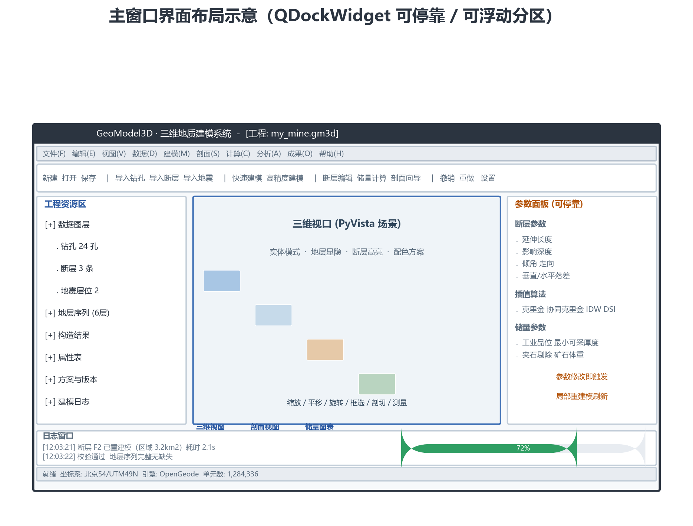

# GeoModel3D · 三维地质建模系统

[](LICENSE)
[](https://www.python.org/)
[](#)

基于 **Python + PyQt6 + PyVista** 的桌面端三维地质建模软件，集成 **GemPy**
隐式势场推断与 **OpenGeode** 拓扑实体适配，覆盖从多源数据导入、三维建模、
断层编辑、储量估算、剖切成图到成果导出的完整工作流。



## 1. 功能概览

- **多源数据导入**：钻孔 CSV/Excel、断层 SHP/JSON、地震趋势面 Esri ASCII/SEG-Y/点云。
- **数据质量校验**：缺列、层序、厚度、品位、CRS、包围盒越界等检查与质量报告。
- **多引擎建模**：GemPy 隐式势场、OpenGeode 实体适配、Mock 轻量分层内核；不可用时自动回退 Mock。
- **统一模型 UMesh**：顶点/单元/属性/面组/元数据统一表示，可视化、储量、剖面、导出共享同一模型。
- **三维交互**：地层着色、钻孔/断层叠加、图层显隐、拾取/框选、剖切、纵向放大、全屏。
- **断层编辑**：参数化断层、影响域预览、局部重建模、Undo/Redo、版本快照。
- **储量估算**：体积法/块段法、边界品位/最小可采厚度/夹石剔除、分级与灵敏度分析、Excel 报告。
- **剖面成图**：水平/任意/平行勘探线剖面、钻孔投影、断层迹线、SVG/PNG/GeoJSON/SHP/DXF 导出。
- **统计分析**：厚度/品位/断层/质量/地层体积统计、图表与 Excel 报表。
- **工程管理**：`.gm3d` 工程包、SHA-256 完整性校验、版本快照、自动保存、崩溃恢复。
- **Headless CLI**：批处理建模、储量、剖面、统计与参数迭代。
- **插件机制**：通过 `geomodel3d.engines` entry point 发现第三方引擎。

## 2. 技术架构

```text
UI (PyQt6)
   │  AppContext / EventBus / TaskManager
   ▼
Services (Project / Data / Modeling / FaultEditor / Reserve / Section / Export / Repair / Stats)
   │
   ├── Engine (ModelingEngine + EngineRegistry + Mock / GemPy / OpenGeode)
   ├── Algorithms (interpolation / geometry / local rebuild / reserve / section / repair / stats)
   └── Data I/O (borehole / seismic / CRS / project package / exporters)
```

- **UMesh** 是引擎中立的核心数据结构；任何引擎的产物都转换为 UMesh，下游分析与导出不依赖具体引擎。
- **事件总线**用于 UI 与服务解耦；后台建模/修复/导出通过 `QThreadPool` 执行。
- 工程包 `.gm3d` 为 Zip，manifest 记录每个文件的 SHA-256，写入采用原子替换。

## 3. 环境与安装

### 基本环境

- Python **3.9+**
- Windows 10/11 x64（当前主要验证平台）
- 依赖：PyQt6、pyvista、pyvistaqt、numpy、scipy、pandas、pydantic、matplotlib、pyproj、fiona、ezdxf、openpyxl

```powershell
# 基础安装
pip install -e .

# 可选：OpenGeode / GemPy 引擎
pip install -e ".[geo]"

# 可选：工程包口令加密（AES-256-GCM）
pip install -e ".[crypto]"

# 开发依赖（pytest / ruff）
pip install -e ".[dev]"
```

### GemPy 隔离环境

GemPy 3.x 需要 Python ≥3.10。若主解释器为 Python 3.9，可将其安装在独立环境中，
并通过环境变量指向该解释器：

```powershell
powershell -ExecutionPolicy Bypass -File packaging\install_gempy_env.ps1
$env:GEOMODEL3D_GEMPY_PYTHON = "<path-to-gempy-env>\python.exe"
```

未安装 GemPy/OpenGeode 时，系统会给出明确提示并回退 Mock 内核，不影响基础建模流程。

## 4. 运行

在仓库根目录执行：

```powershell
# 启动桌面 GUI（建议使用已安装 PyQt6 的主环境）
python -m geomodel3d

# 或安装后的命令
geomodel3d

# headless 批处理
geomodel3d-cli run --job examples\demo\job.json --out out
```

无 OpenGL 的环境（CI/服务器/自动化测试）可设置：

```powershell
$env:QT_QPA_PLATFORM="offscreen"
$env:GEOMODEL3D_NO_VTK="1"
```

## 5. 数据与格式

| 类型 | 支持格式 |
|---|---|
| 钻孔 | CSV、Excel（xlsx/xls）；支持中英文列名与手工列映射 |
| 断层 | SHP、JSON |
| 地震趋势面 | Esri ASCII（asc/grd）、SEG-Y（sgy/segy）、CSV/TXT 点云 |
| 工程包 | `.gm3d`（Zip + manifest SHA-256） |
| 三维导出 | VTU、OBJ、STL、PLY、GLB、OpenGeode `.og_hso3d`（可选） |
| 剖面导出 | GeoJSON、SHP、DXF、SVG、PNG |
| 报表 | 储量 XLSX、统计图表 PNG、统计报表 XLSX |

## 6. 目录结构

```text
geomodel3d/         核心 Python 包
  app/              入口、AppContext、事件总线、任务、主题、日志
  ui/               PyQt6 主窗口、控件、对话框、向导
  domain/           领域实体、规则、工程/快照/储量/剖面模型
  services/         业务用例服务
  engine/           UMesh、引擎适配器与注册表
  algorithms/       插值、几何、局部重建、储量、剖面、修复、统计
  dataio/           钻孔/地震/CRS/工程包/导出
  jobs/             headless CLI
  config/           schema、默认值、错误码、主题 QSS
tests/              pytest 单元/集成/UI 冒烟
examples/           演示数据与 Job 示例
packaging/          PyInstaller 配置与 GemPy 环境脚本
scripts/            本地 CI 冒烟脚本
assets/             README 与界面图片
```

## 7. 测试

```powershell
python -m pytest -q
```

覆盖范围包括：配置 schema、业务规则、插值（IDW/克里金/协同克里金）、UMesh、
引擎调度与 Mock/GemPy/OpenGeode 适配、钻孔与地震解析、工程包完整性、储量、
剖面、导出、网格体检与修复、局部重建模、空间索引兜底、快照/自动保存、
统计分析、数据回归、性能预算、服务层端到端、UI 冒烟与无 VTK 环境。

## 8. 性能基准

```powershell
geomodel3d-bench --resolution 100 100 20      # 20 万单元
geomodel3d-bench --resolution 100 100 100     # 100 万单元
```

基准会输出建模、体积、体检、剖面、储量等阶段耗时。具体数值取决于 CPU、内存、
Python 版本与依赖环境，请以本机实际输出为准。

## 9. 打包发布

```powershell
pyinstaller --clean --noconfirm --distpath dist --workpath build packaging\geomodel3d.spec
```

冻结产物自检：

```powershell
$env:GEOMODEL3D_SELF_TEST="1"
$env:QT_QPA_PLATFORM="offscreen"
$env:GEOMODEL3D_NO_VTK="1"
.\dist\GeoModel3D\GeoModel3D.exe
echo $LASTEXITCODE
```

- 发布包在 **GitHub Releases** 提供，仓库不提交 `build/`、`dist/` 等二进制产物。
- 冻结版不内置 OpenGeode 原生库；需要高精度实体时请在源码环境运行或配置外部依赖。

## 10. 持续集成

```powershell
powershell -ExecutionPolicy Bypass -File scripts\ci_smoke.ps1
```

CI 配置见 `.github/workflows/ci.yml`，覆盖 Windows + Python 3.9/3.10/3.11
的编译、测试与打包自检。

## 11. 已知限制

- 开源 `opengeode-core` 不提供拓扑布尔切割与原生 DSI；当前断层以落差位移近似，
  另提供 VTK 几何切割预览，但不等同于 OpenGeode 商业布尔实体。
- 文中/软件中的 DSI 为开源近似实现（邻域平滑 + 硬约束），不是 OpenGeode 原生 DSI。
- 储量分级 331/332/333 为参照分类框架，不能替代 JORC/GB/T 17766 正式资源量报告、
  Competent Person 审核或采矿设计。
- 三维建模与储量结果依赖输入数据、CRS、网格分辨率与参数选择；工程使用前应进行
  独立复核。
- 大网格、复杂断层、薄层与稀疏钻孔场景仍可能出现性能或精度限制。
- 打包版依赖 PyQt6/VTK/GDAL 等第三方库，首次启动与显存/OpenGL 环境相关。

## 12. 许可证

本仓库源代码采用 **MIT License**，详见 [LICENSE](LICENSE)。

第三方依赖遵循其各自许可证。其中 PyQt6 为 GPLv3/商业双许可，分发二进制或商业使用前
请确认符合其许可要求；GemPy、OpenGeode、VTK、PyVista 等依赖的许可信息请参阅各自项目。
