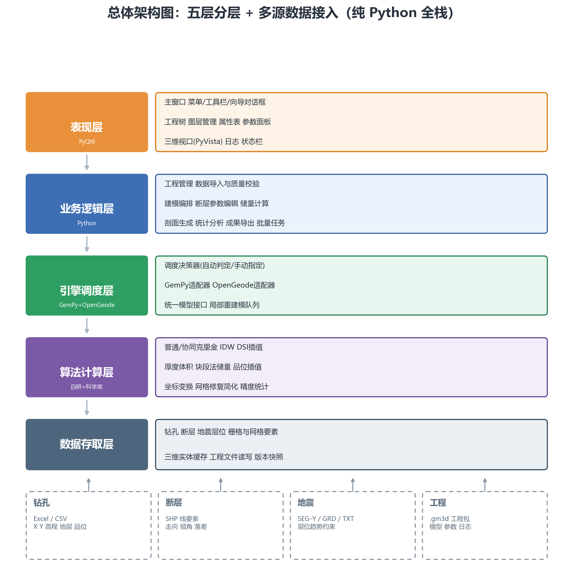
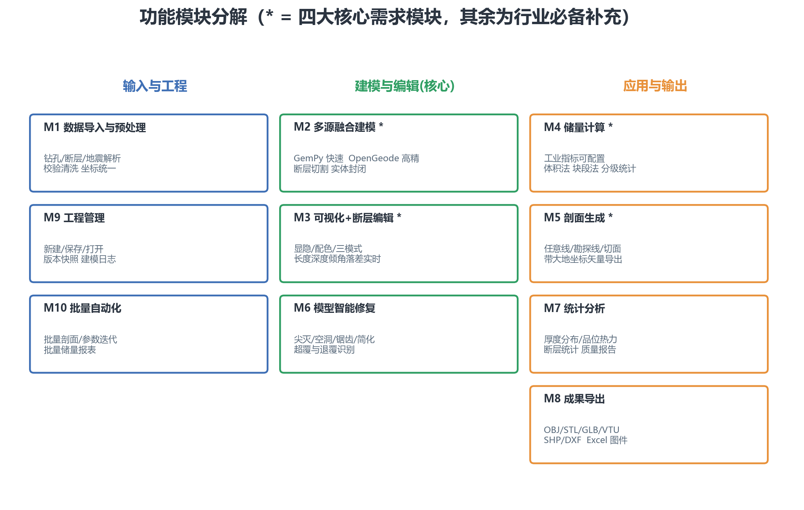
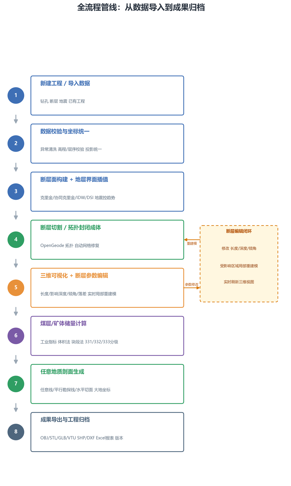
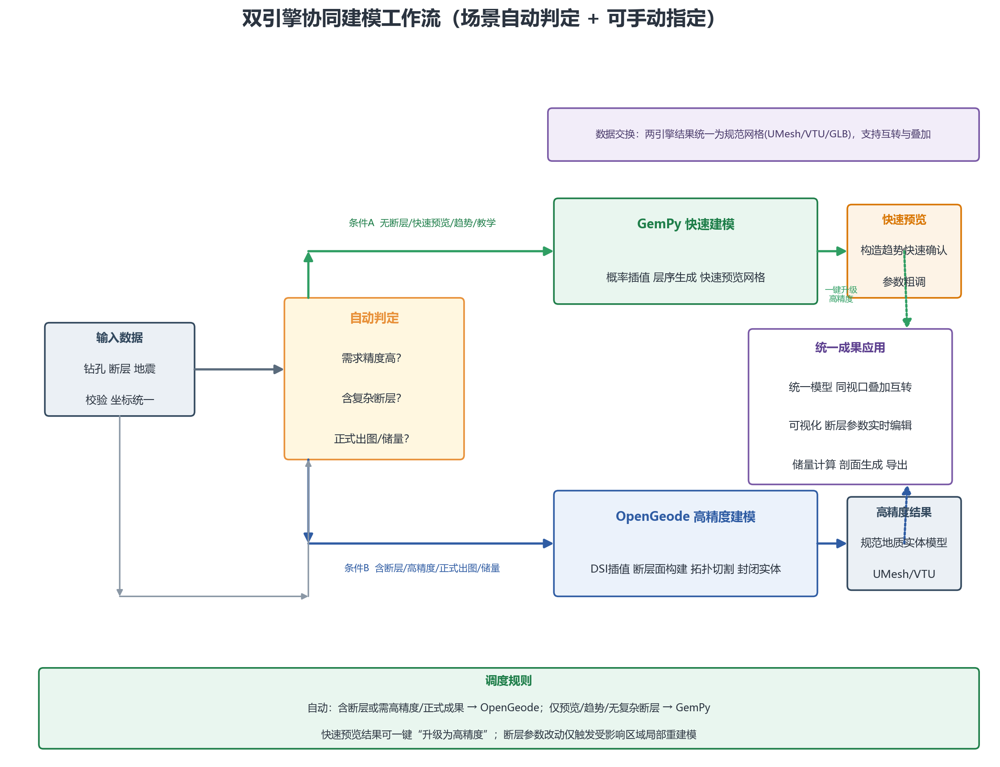
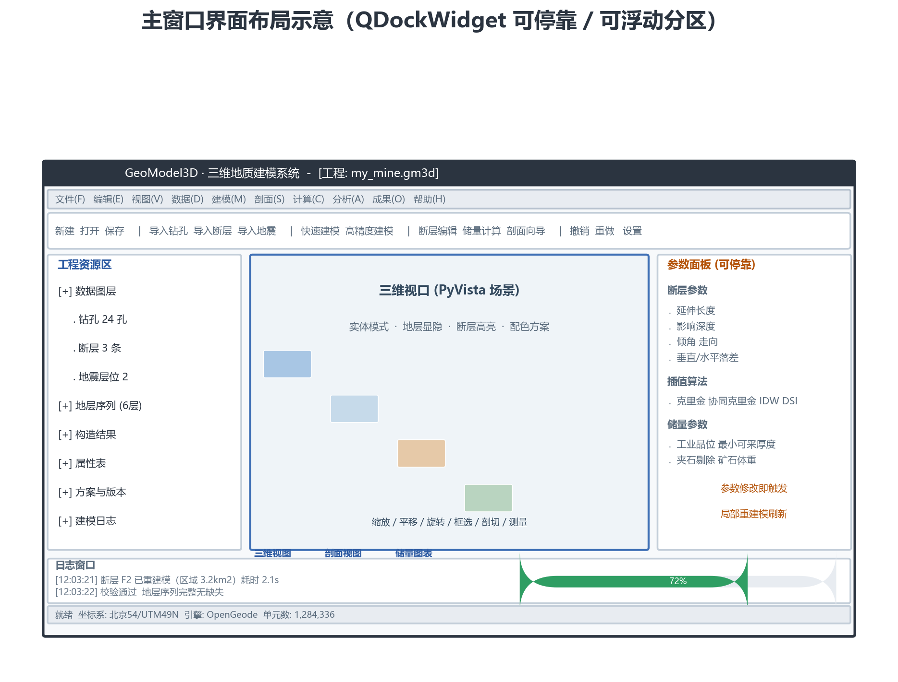

# 基于 Python + GemPy + OpenGeode 的三维地质建模软件 详细设计方案（完善版）

> **文档性质**：详细设计方案（Detailed Design Document）
> **版本**：v2.0（完善版，自 v1.0 全面改写扩充）
> **编制日期**：2026-09-08
> **阅读对象**：产品、研发、测试、地质建模业务顾问、项目验收方
> **配套图件**：本文档所有插图位于同目录 `assets/` 文件夹，引用方式 `./assets/*.png`，请保持文档与文件夹同级存放。

## 修订记录

| 版本 | 日期 | 修订说明 | 责任方 |
| --- | --- | --- | --- |
| v1.0 | 原始版 | 软件总体介绍、五层架构、六大模块、双引擎机制、GUI 布局、部署方式初稿 | 原始作者 |
| v2.0 | 2026-09-08 | 新增需求分析、领域模型、核心流程、逐模块详细设计、算法设计、界面设计规范（配色/字体/布局/交互/状态机）、数据与接口设计、实施与测试计划、风险与附录；重绘全部架构/流程/界面图件 | 完善小组 |

### v2.0 相对 v1.0 的增强要点（对照原需求"功能完善、界面美观、设计合理"）

| 关注点 | 原方案不足 | 完善版对策 | 对应章节 |
| --- | --- | --- | --- |
| 功能完善 | 只有功能列举，缺需求基线、业务规则、输入输出与验收标准 | 建立完整需求清单（FR/NFR/BR）、每个模块给出功能点表、数据结构、流程、异常处理 | 第 2、5 章 |
| 功能完善 | 未涉及撤销/重做、自动保存、坐标系严谨性、错误处理与日志体系 | 新增全局交互框架、坐标系服务、工程版本与快照、日志/错误码规范 | 第 3、5、7、8 章 |
| 界面美观 | 仅一段布局文字 | 给出可视化配色/字体/间距规范、深浅双主题、主窗口线框示意图、鼠标与快捷键约定、空态与加载态设计 | 第 7 章 |
| 设计合理 | 引擎耦合方式、调度规则、模型表示均较模糊 | 引入引擎适配器模式、统一模型表示（UMesh/VTU）、事件总线解耦、异步 Worker 模型、算法选型矩阵 | 第 3、4、6、8 章 |
| 设计合理 | 无实施与测试、打包、风险计划 | 新增里程碑、测试策略、PyInstaller 打包与许可证、风险清单 | 第 9 章 |

---

## 目录

1. [项目概述](#1-项目概述)
2. [需求分析](#2-需求分析)
3. [系统总体设计](#3-系统总体设计)
4. [核心业务流程设计](#4-核心业务流程设计)
5. [功能模块详细设计](#5-功能模块详细设计)
6. [核心算法设计](#6-核心算法设计)
7. [界面设计规范](#7-界面设计规范)
8. [数据与接口设计](#8-数据与接口设计)
9. [实施、测试与交付](#9-实施测试与交付)
10. [风险与对策](#10-风险与对策)
11. [附录](#11-附录)

---

# 1 项目概述

## 1.1 项目定位

本项目基于**纯 Python 技术栈**开发一套**桌面端三维地质建模系统**，面向矿山、煤炭、地质勘查、油气勘查等行业，把"钻孔、断层、三维地震反演"三类多源数据组织为**统一坐标系下的三维地质实体模型**，并向下游提供"模型可视化、断层参数可控编辑、矿体储量计算、任意地质剖面生成、成果矢量/栅格/报表导出"完整能力。

软件定位为：

- **轻量化**：单机桌面软件，可独立打包为 Windows EXE，免环境安装、开箱即用；
- **全 Python**：以 Python 3.10 为主语言，研究、调试、二次开发成本低；
- **双引擎融合**：GemPy 负责快速迭代预览与趋势分析，OpenGeode 负责高精度拓扑、断层切割与商用成果输出，二者取长补短；
- **地质业务闭环**：覆盖"数据 → 模型 → 编辑 → 计算 → 图件/报告"的完整工程链条。

## 1.2 建设目标

| 维度 | 目标 |
| --- | --- |
| 建模能力 | 三类多源数据融合建模，支持复杂断层切割、地层错动、封闭实体构建 |
| 可视化 | 大模型流畅浏览（目标 >100 万单元不低于 25 FPS 旋转/平移） |
| 断层编辑 | 断层长度、影响深度、倾角、落差等参数 GUI 可调，修改后局部重建模并在秒级内刷新（目标 ≤ 5s/次，视规模） |
| 储量计算 | 支持工业指标配置、体积法与块段法、储量分级统计（331/332/333），输出评审级报告 |
| 剖面能力 | 任意方向剖面 + 平行勘探线 + 水平切面，带真实大地坐标导出 SHP/DXF/GeoJSON |
| 工程管理 | 工程文件打包保存、多版本快照、建模日志可追溯 |
| 交付形态 | PyInstaller 单 EXE/免安装目录，Windows 10/11 x64 运行 |

## 1.3 目标用户与典型场景

| 角色 | 主要诉求 | 典型场景 |
| --- | --- | --- |
| 地质建模工程师 | 快速成模、参数试探、成果受控 | 导入 24 个钻孔 + 3 条断层 + 2 层地震层位，10 分钟内出首版模型 |
| 采矿/储量工程师 | 矿体圈定、分级、报告 | 按工业指标自动计算块段矿量，输出 331/332/333 分级报表 |
| 勘探/设计人员 | 图件生产、坐标准确 | 沿勘探线批量切剖面，带大地坐标导入 QGIS/CAD |
| 项目负责人 | 版本与过程追溯 | 查看建模日志、方案快照对比、一键导出全套成果 |
| 教学/演示用户 | 快速、可解释、易上手 | 用模板数据走通"导入→建模→编辑→出图"演示链 |

## 1.4 开发技术栈（严格按需求并给出版本与用途）

| 类别 | 技术/库 | 用途 | 说明 |
| --- | --- | --- | --- |
| 语言 | Python 3.10+ | 全栈主语言 | 3.10 为基线，兼容 3.11 |
| GUI | PyQt6 | 窗口、菜单、工具栏、停靠面板、向导、对话框 | 商用许可友好（GPLv3/GPL 例外） |
| 快速建模 | GemPy（含 gempy-plot 等） | 概率插值、地层层序、初始模型、快速预览 | LGPL-3.0 |
| 拓扑/实体 | OpenGeode-core（Python 绑定） | 断层面拓扑、布尔切割、封闭实体、剖面求交、网格修复 | MIT |
| 三维渲染 | PyVista（VTK 封装） | 三维视口、等值面、切面、标注、截图 | MIT/BSD |
| 数值计算 | NumPy / SciPy | 数组运算、线性代数、插值辅助、求交 | BSD |
| 表格数据 | Pandas | 钻孔/报表数据整理 | BSD |
| 空间栅格/矢 | GDAL / OGR（Fiona 可选） | 读 SHP/GeoTIFF/GRD、坐标系变换、矢量读写 | MIT/X |
| 插值 | PyKrige（自研封装兜底） | 普通/协同克里金 | BSD |
| 配置/序列化 | Pydantic、JSON/msgpack | 工程文件与参数 schema、类型校验 | MIT |
| 异步/线程 | QtConcurrent / QThreadPool | 后台建模任务、取消机制 | Qt |
| 测试 | pytest、pytest-qt | 单元/集成/UI 测试 | MIT |
| 打包 | PyInstaller | 单 EXE/目录发布 | GPL 例外许可 |

## 1.5 术语与缩写

| 术语 | 含义 |
| --- | --- |
| 钻孔数据 | 含孔口坐标（X/Y/孔口高程）、分层（层号、顶底深或顶底高程、厚度、品位）的观测数据 |
| 断层 | 以走向/倾向/倾角/落差/延伸长度/影响深度等参数描述的构造面 |
| 地震层位 | 地震反演/解释得到的某地质界面趋势面（GRD/SEG-Y 薄层/点云） |
| 界面（surface） | 两个相邻地层之间的分界面 |
| 实体（solid/body） | 封闭的地质体/矿体，具有封闭三角网格 |
| 块段法 | 将矿体按规则块体划分后逐个计算储量的方法 |
| 资源量编码 | 331（探明）、332（控制）、333（推断）等固体矿产资源储量分级 |
| UMesh | 本项目统一的三维网格模型表示（顶点+单元+属性） |
| VTU | VTK 非结构化网格文件格式，作为中间交换格式 |
| CRS | 坐标系（Coordinate Reference System） |
| DoD | 影响深度/切割深度（Depth of Influence） |
| Rebuild | 局部重建模：仅重算受影响区域以提升响应速度 |

## 1.6 设计原则

1. **关注点分离**：UI、业务、引擎、算法、数据严格分层，禁止跨层混用。
2. **引擎中立（Adapter）**：业务只面向统一的"建模引擎接口"，GemPy/OpenGeode 是可替换适配器，杜绝厂商锁定。
3. **数据驱动建模**：把地质约束（钻孔=硬约束、断层=拓扑约束、地震=趋势约束）统一为可插拔的约束体系。
4. **用户可逆与安全**：所有破坏性操作支持撤销/重做；工程自动保存与版本快照。
5. **异步不卡界面**：耗时任务一律进入后台线程，带进度、可取消。
6. **坐标严谨**：全系统统一 CRS 与误差控制，导出成果带真实大地坐标。
7. **可测试**：算法与引擎调度可 headless 调用，支持数据回归。

# 2 需求分析

> 本章为功能基线与验收依据。需求项均有唯一编号（FR/NFR/BR），便于贯穿全文追踪。

## 2.1 功能需求总览（FR 清单）

优先级采用 MoSCoW：**M**ust（必须有）/ **S**hould（应该有）/ **C**ould（可以有）/ **W**on't（本期不做）。

| 编号 | 模块 | 需求描述 | 优先级 |
| --- | --- | --- | --- |
| FR-01 | M1 数据导入 | 导入 Excel/CSV 钻孔，支持模板列识别与自定义映射 | M |
| FR-02 | M1 数据导入 | 导入 SHP 断层线并自动/手动提取走向、倾向、倾角、落差 | M |
| FR-03 | M1 数据导入 | 导入 SEG-Y、GRD、TXT 地震层位/趋势面 | M |
| FR-04 | M1 预处理 | 去异常、空值清洗、高程合理性、地层顺序与缺失校验、去重 | M |
| FR-05 | M1 坐标 | 全数据统一到同一投影 CRS，导出坐标与导入坐标可回退 | M |
| FR-06 | M2 建模 | GemPy 快速建模：概率插值→层序→快速预览网格 | M |
| FR-07 | M2 建模 | OpenGeode 高精度建模：DSI 插值→断层面→切割→实体封闭→修复 | M |
| FR-08 | M2 融合 | 钻孔硬约束 + 断层拓扑约束 + 地震趋势约束的优先级融合 | M |
| FR-09 | M2 融合 | 克里金/协同克里金/IDW/DSI 四类插值算法可选可配 | M |
| FR-10 | M3 可视化 | 地层/断层/钻孔分层显隐、透明度、自定义颜色 | M |
| FR-11 | M3 可视化 | 线框/实体/网格三种显示模式；旋转/平移/缩放/框选/剖切/测量 | M |
| FR-12 | M3 断层编辑 | GUI 编辑断层长度、影响深度、倾角、走向、垂直/水平落差，实时刷新 | M |
| FR-13 | M3 通用交互 | 撤销/重做、右键菜单、拖放导入、快捷键 | M |
| FR-14 | M4 储量 | 工业品位、最小可采厚度、夹石剔除、矿石体重等指标可配置 | M |
| FR-15 | M4 储量 | 三维体积法、块段法、克里金品位赋值 | M |
| FR-16 | M4 储量 | 输出矿石量、金属量、平均厚度、平均品位与 331/332/333 分级 | M |
| FR-17 | M4 储量 | 储量报告（Excel）与统计图表 | M |
| FR-18 | M5 剖面 | 任意手绘剖面线、自动平行勘探线、水平地层切面 | M |
| FR-19 | M5 剖面 | 剖面内容含地层界线、矿体轮廓、断层迹线、钻孔、标高/厚度标注 | M |
| FR-20 | M5 剖面 | 真实大地坐标导出 SHP/DXF/GeoJSON/SVG/PNG | M |
| FR-21 | M6 修复 | 尖灭、空洞、锯齿、简化、超覆/退覆识别与处理 | S |
| FR-22 | M7 统计 | 厚度分布、品位热力、断层统计、数据质量报告 | S |
| FR-23 | M8 导出 | 三维 OBJ/STL/VTU/GLB；二维 SHP/DXF/SVG/PNG；报表 Excel/CSV | M |
| FR-24 | M8 导出 | 导出前检查单、坐标/比例尺/图层命名规范校验 | S |
| FR-25 | M9 工程 | 新建/保存/打开工程；自动保存；版本快照；建模日志 | M |
| FR-26 | M10 批量 | 批量剖面、批量参数迭代建模、批量储量报表；headless CLI | C |
| FR-27 | M10 扩展 | 参数文件驱动 + 结果目录，支持脚本化流水线 | C |
| FR-28 | 外壳 | 帮助系统、关于与版本、检查更新入口、模板数据示例 | S |
| FR-29 | 外壳 | 应用设置（主题、语言、日志级别、默认目录、CRS 默认值） | S |

## 2.2 关键业务规则（BR）

| 编号 | 业务规则 |
| --- | --- |
| BR-01 | 建模约束优先级：**钻孔硬约束 > 断层拓扑约束 > 地震趋势约束**；冲突时低优先级以软约束/趋势参与插值，不直接改硬数据。 |
| BR-02 | 钻孔校验规则：同一孔内相邻层位顶底不得倒置；不同钻孔间地层代码须来自受控地层字典；越界品位/厚度给出告警并可剔除。 |
| BR-03 | 断层编辑生效范围：断层的水平覆盖 = 延伸长度决定的走向带；竖向切割上限 = 影响深度；**仅对落入影响域内的网格/实体发起局部重建模**。 |
| BR-04 | 储量计算前必须通过"工业指标+可采范围"双校验：厚度 < 最小可采厚度的夹层剔除规则；低品位段是否可并入邻段（米-克/吨规则可配置）。 |
| BR-05 | 储量分级口径：探明(331)、控制(332)、推断(333) 由用户按工程规范在分级参数中定义（如控制点间距/品位变化系数/勘探网度），软件按该口径自动分级并允许人工局部修正。 |
| BR-06 | 剖面导出比例尺、投影带、图廓坐标必须显式校验，防呆：默认禁止"无 CRS 导出"。 |
| BR-07 | 每项破坏性操作入 Undo 栈；工程自动保存间隔与快照数量可在设置中调整。 |
| BR-08 | 建模任务的进度必须可取消；取消后回到最近一致状态（通过版本快照回滚）。 |
| BR-09 | 导出三维模型前执行拓扑体检：非流形边、重复面、空洞、法向一致性；不合格给出修复建议或强制修复。 |

## 2.3 非功能需求（NFR）

| 类别 | 指标 |
| --- | --- |
| 性能 | 万级钻孔分层（≤10^5 记录）预处理 < 10s；10^6 单元渲染交互 ≥ 25FPS（中档独显）；断层局部重建模 ≤ 5s（10^5 级区域）；储量计算 10^6 单元 < 30s |
| 规模 | 单工程支持钻孔 ≤ 5000 孔、断层 ≤ 200 条、模型单元 ≤ 5×10^6；超限提示降采样/分块策略 |
| 内存 | 5×10^6 单元建模峰值内存 ≤ 8GB；长任务采用增量缓存 |
| 兼容 | Windows 10/11 x64；支持 100%/125%/150% HiDPI；支持多显示器拖拽停靠 |
| 稳定性 | 崩溃率目标 < 1‰ 会话；异常统一捕获并写崩溃转储（可用 minidump） |
| 安全 | 工程文件含坐标等敏感数据，可选加密（口令派生 AES）；日志不落明文敏感信息 |
| 可维护 | 算法核心可 headless 调用；代码行覆盖率目标 ≥ 70%（核心算法 ≥ 85%） |
| 可用性 | 关键路径（导入→建模）≤ 5 步；新手在模板数据上 ≤ 30 分钟独立完成首模 |

## 2.4 数据规模假设（设计输入）

典型工程：24 孔 × 平均 8 层 ≈ 200 分层记录；3 条断层；2 层地震趋势面；建模范围 5km×5km；纵向网格分辨率 20~50m，单元量 10^5~10^6 量级。算法与缓存设计以上述量级为基准，并支持放大一个数量级的配置项。

---

# 3 系统总体设计

## 3.1 架构总览（五层 + 统一模型 + 事件总线）



**图 3-1 总体架构：五层分层 + 多源数据接入**

| 层 | 职责 | 技术载体 | 依赖方向 |
| --- | --- | --- | --- |
| UI 表现层 | 窗口、菜单、工具栏、向导、工程树/属性表、参数面板、三维视口、日志/状态栏、主题 | PyQt6 + PyVista widget | 只依赖业务层接口 |
| 业务逻辑层 | 工程管理、导入校验、建模编排、断层编辑、储量、剖面、统计、导出、批量 | Python 用例服务（Use-case Services） | 依赖引擎与算法抽象 |
| 引擎调度层 | 场景判定、GemPy/OpenGeode 适配、统一模型输出、局部重建模队列 | Adapter 模式 + 队列 | 依赖算法层抽象 |
| 算法计算层 | 插值族、厚度/体积/储量、品位插值、求交/切割、网格修复、坐标变换 | NumPy/SciPy/PyKrige/OpenGeode kernel | 依赖数据层抽象 |
| 数据存取层 | 数据源解析、CRS 服务、统一模型存储、工程文件、版本快照、缓存 | Pandas/GDAL/Pydantic | 无业务依赖 |

**横向基础设施（贯穿各层）**：

- **统一模型表示 UMesh**：任一引擎产物均归一为 UMesh（顶点、单元、单元属性、地层/断层标签、来源元数据），可视化、储量、剖面、导出都只消费 UMesh，从而解耦引擎。
- **事件总线**：模型变更、任务状态、参数变化、日志等以事件发布；UI 订阅刷新，业务不直接引用控件。
- **异步 Worker**：耗时任务（导入、建模、重建模、储量、导出）提交到 QThreadPool，统一进度/取消/异常上报。

## 3.2 关键设计决策（ADR 摘要）

| 决策 | 选项 | 结论 | 理由 |
| --- | --- | --- | --- |
| GUI | PySide6 vs PyQt6 | **PyQt6**（需求指定） | 生态成熟、文档全；许可证评估通过 |
| 引擎耦合 | 直接调用 vs 适配器 | **适配器 + UMesh** | 可替换引擎、便于回归测试与 license 隔离 |
| 模型交换 | 专有对象 vs 开放格式 | **UMesh 内存 + VTU/GLB 落盘** | 可视化/分析/导出直接复用 VTK/OpenGeode 生态 |
| 线程 | 单线程 vs 线程池 | **QThreadPool + 队列** | GUI 不卡顿；任务可取消 |
| 状态 | 无版本 vs 快照 | **写时快照（工程包内增量版本）** | 支撑撤销与方案对比 |
| 配置 | 散配置 vs 集中 schema | **settings.json + 工程 *.gm3d 内 config** | 可校验、可版本化 |

## 3.3 领域模型（核心实体）

核心实体及其关系（建模阶段概念）：

```
Project(1) ──<has>── DataSource[] (Drillhole/Fault/Seismic)
Project(1) ──<has>── Stratigraphy{layer_code, order, color}
Project(1) ──<has>── ModelRun[] {engine, params, created, status}
Project(1) ──<has>── ReservePlan[] / SectionPlan[] / ExportBundle[]
ModelRun(1) ──produces── UnifiedMesh (UMesh)
Drillhole(1) ──<has>── Interval[] {depth_top/bottom, layer, thickness, grade}
Fault(1) ──parametrized── FaultParams{length, depth_of_influence, dip, strike, throw_v, throw_h, shape}
UMesh(1) ──<has>── SolidBody[] / Surface[] / BoreholeTrace[]
Section(1) ──<has>── SectionLine + SectionContent {polylines, labels}
```

| 实体 | 关键属性 | 说明 |
| --- | --- | --- |
| Project | id, name, crs_epsg, crs_proj4, bounds, settings | 工程根对象 |
| Drillhole | hole_id, x, y, collar_elev, total_depth, intervals[] | 原始与标准化后均保留 provenance |
| Stratigraphy | layer_code, order, name, default_color, alpha | 全局地层字典（可导出/导入） |
| Fault | fault_id, trace_polyline, side, params, status | 几何 + 参数化 |
| ModelRun | run_id, engine, params_snapshot, input_hash, status, log | 每次建模/重建模可复现（参数快照） |
| UnifiedMesh | vertices, cells, cell_attr, face_groups, meta | 统一模型 |
| ReservePlan | mineral, params(指标), method, blocks, results | 储量方案 |
| SectionPlan | kind(任意/勘探线/水平), line_geom, dpi, crs | 剖面方案 |

## 3.4 功能模块分解



**图 3-2 功能模块分解（10 个模块：3 输入工程 / 3 建模核心 / 4 应用输出；其中 M2、M3、M4、M5 对应四大核心需求）**

模块清单及其在代码中的服务归属见 5 章；模块间通过服务接口 + 事件总线协作，不直接调用其他模块 UI。

## 3.5 工程文件与数据组织

推荐工程目录（保存为单文件工程包 `*.gm3d`，本质为 Zip）：

```
my_mine.gm3d
├── manifest.json          # 工程清单（版本、CRS、schema 版本、文件清单+校验和）
├── config.json            # 工程设置与默认参数
├── stratigraphy.json      # 地层字典
├── data/
│   ├── boreholes.csv      # 标准化钻孔（含校验标记）
│   ├── faults.json        # 断层参数化结果
│   └── seismic_trends/    # 地震趋势面归一化栅格
├── models/
│   ├── runs/              # 每次 ModelRun 产物与参数快照
│   └── unified/
│       └── latest.vtu
├── versions/              # 快照（增量 manifest + 差异块）
├── sections/  reserves/  exports/
└── logs/
    └── modeling.log
```

**工程包设计要求**：写入采用临时目录 + 原子替换；manifest 内记录每个文件的 SHA-256；打开时校验完整性，损坏时回退最近版本快照并告警。

## 3.6 运行模型与线程模型

- 主线程（Qt UI）只做轻量绘制与事件；
- 后台线程池执行：导入/校验、建模、重建模、储量、剖面、导出（每类一个任务队列，互不饿死）；
- 单一 `TaskManager`：提交、进度（0~100%）、取消、异常、结果缓存；
- 长任务开始时自动建立版本快照（可回滚）；结束时广播 `ModelChanged` 事件。

## 3.7 配置管理

- 用户级 `settings.json`（主题、语言、默认 CRS、日志级别、自动保存间隔）；
- 工程级 `config.json`（覆盖用户默认）；
- 参数 schema 用 Pydantic 模型定义，非法参数在 UI 即时红框提示并阻止执行。

# 4 核心业务流程设计

## 4.1 业务主流程



**图 4-1 全流程管线：数据导入 → 预处理 → 建模 → 可视化/断层编辑 → 储量 → 剖面 → 导出归档**

| 步 | 环节 | 关键活动 | 退出条件/产物 |
| --- | --- | --- | --- |
| 1 | 新建/导入 | 新建工程或打开既有工程；导入三类数据 | 数据源就绪、可预览 |
| 2 | 校验/坐标 | 规则引擎校验；CRS 归一；生成质量报告 | 校验通过或有明确处置 |
| 3 | 界面构建+插值 | 选插值算法族与约束组合 | 地层界面点云/曲面 |
| 4 | 切割封闭 | OpenGeode 断层切割、实体封闭、修复 | UMesh（含多实体） |
| 5 | 可视化+编辑 | 三维检查；断层参数修改→局部重建模（闭环见 4.4） | 模型满足预期 |
| 6 | 储量计算 | 配指标→体积/块段→分级 | 储量报告 |
| 7 | 剖面生成 | 选线型→切剖面→标注 | 剖面图/矢量 |
| 8 | 导出归档 | 检查单→多格式导出→版本快照 | 成果包 |

主流程支持任意阶段的**回退与旁路**（例如无断层时可直接跳到储量），不强制顺序。

## 4.2 数据导入与预处理子流程

```
选择数据源 → 格式解析(模板映射) → 结构校验 → 规则校验(BR-02)
   → 异常清单交互(修复/剔除/忽略，留痕) → CRS 判定与变换
   → 写标准化库(data/) → 广播 DataReady
```

| 步骤 | 要点 | 产出 |
| --- | --- | --- |
| 解析映射 | CSV/Excel 列名模糊匹配 + 用户拖拽映射，列缺失直接报错 | 标准 DataFrame |
| 结构校验 | 类型、必填、重复孔号、断链（钻孔未穿透地层等） | 问题表 |
| 规则校验 | 顶底倒置、厚度≤0、品位域、地层字典一致性 | 问题分级（错误/告警/提示） |
| 异常处置 | 逐条确认修复或剔除；处置动作进入 provenance 字段 | 处置记录 |
| CRS 归一 | 支持 EPSG/用户自定义参数；记录"源 CRS→目标 CRS"链 | CRS 元数据 |
| 结果 | 全部硬错误清零后允许进入建模 | 标准化数据 |

> **数据质量报告（可导出 PDF/Excel）** 是验收证据，系统在每一步保存质量指标（缺失率、越界率、规则命中率）。

## 4.3 双引擎协同建模子流程



**图 4-2 双引擎协同建模工作流（自动判定 + 手动指定 + 一键升级）**

### 4.3.1 引擎职责边界

| 维度 | GemPy（快速） | OpenGeode（高精度） |
| --- | --- | --- |
| 适用 | 无/少复杂断层、趋势分析、快速预览、教学 | 复杂断层切割、高精度矿体、正式出图、储量、商用成果 |
| 插值 | 概率插值（Theano）快速成层 | DSI 光滑插值 + 可控网格 |
| 拓扑 | 弱（不保证实体封闭） | 强（拓扑切割、封闭实体、网格修复） |
| 输出 | 快速预览网格 | UMesh/VTU 规范实体 |

### 4.3.2 调度决策（伪代码）

```python
def decide_engine(ctx):
    if ctx.manual_engine:                    # 用户显式指定优先
        return ctx.manual_engine
    if ctx.has_faults or ctx.need_high_precision or ctx.target == 'reserve/section/export':
        return Engine.OPENGEODE
    if ctx.purpose in ('quick_preview', 'trend', 'teaching'):
        return Engine.GEMPY
    return Engine.OPENGEODE                  # 默认从严
```

- 自动选择结果在界面上提示并可被用户覆盖；
- **快速预览 → 高精度升级**为无摩擦路径：同一 UMesh 输入，GemPy 结果只作预览，升级后以 OpenGeode 重算正式成果；
- 参数或数据变更时，仅对**受影响区域**入队局部重建模（见 4.4）。

## 4.4 断层参数编辑闭环（局部重建模）

```
用户在断层编辑器改动参数
 → 校验(倾角域[0,90]等) → 确定影响域(沿断层带×DoD 竖向范围)
 → 从统一模型中挖出受影响区域子网格
 → 后台任务：更新断层面几何 → 重切割/重插值(局部)
 → 接缝处光顺过渡 → 写回 UMesh → 广播 ModelChanged → 视口增量刷新
 → 入 Undo 栈（与参数快照绑定，可整步回退）
```

| 关注点 | 约定 |
| --- | --- |
| 响应时间 | ≤5s 目标；超长任务先给预览占位并后台完成 |
| 一致性 | 影响域外数据零改动；接缝连续（G1）过渡 |
| 可追溯 | 每次编辑生成一条 `ModelRun` 记录（参数快照+耗时+重算范围） |
| 冲突 | 编辑中禁止二次提交同一区域，任务合并/去重 |

## 4.5 储量计算子流程

```
圈定矿体(来自 UMesh 对应地层/矿体实体)
 → 设定工业指标(品位/厚度/夹石/体重) 
 → 选定方法(体积法 | 块段法) 及分级口径(BR-05)
 → 品位插值(克里金) 或 已有品位属性
 → 计算体积/矿石量/金属量/平均厚度/平均品位 → 分级汇总
 → 生成报告(xlsx/图表) 与 块体几何成果(shp/glb) → 归档
```

> 允许"指标变更→重算"，参数快照保证报告版本可追溯；输出工作簿结构见 8.5。

## 4.6 剖面生成子流程

```
选定剖面类型(任意线/平行勘探线/水平切面)
 → 定义切面几何与输出参数(比例尺/CRS/内容开关)
 → 求交：与 UMesh 各界面/矿体/断层迹线求交(OpenGeode kernel)
 → 钻孔投影与标注(沿剖面走向窗口内投影，含偏移规则)
 → 绘制剖面(地层花纹/界线/色标) + 高程/厚度标注
 → 校验坐标与比例尺(BR-06) → 矢量导出(SHP/DXF/GeoJSON)或位图(PNG/SVG)
```

## 4.7 模型修复与质检子流程

```
自动体检(流形性/空洞/锯齿/尖灭/超覆退覆/法向)
 → 缺陷列表分级 → 自动修复(几何清理/拓扑缝合/光顺/简化)
 → 或人工选择策略 → 复检 → 输出质检报告
```

> 质检报告与修复记录随版本归档，作为成果合规性证据。

---

# 5 功能模块详细设计

> 每个模块统一给出：**定位 / 功能点 / 输入输出 / 主要流程 / 界面要素 / 异常处理 / 对外服务**。模块间不互调 UI，仅通过服务层与事件协作。

## 5.0 模块图例与关系


**图 5-1 模块分解与依赖（参考，完整规格见下文）**

模块依赖原则：`M9(工程) + M1(导入)` 为底座；`M2(建模)` 依赖 M1；`M3(可视化/编辑)` 消费 M2 产物；`M4/M5/M6/M7` 均消费统一模型与 M3 的编辑结果；`M8/M10` 面向全体下游模块提供导出与批处理。

## 5.1 模块 M1：多源地质数据导入与预处理系统

### 定位
把三类异构数据解析、校验、清洗、坐标归一，产出标准化的、带质量标记的数据源。

### 功能点

| 编号 | 功能 | 说明 |
| --- | --- | --- |
| M1-F1 | 钻孔导入 | Excel/CSV；模板识别与手工列映射；预览前 200 行 |
| M1-F2 | 钻孔预处理 | 空值清洗、异常剔除、高程/层序校验、重复孔处理、品位域检查 |
| M1-F3 | 断层导入 | SHP 线要素；自动求走向/倾向；交互输入倾角/落差等；支持 CAD 样条简化 |
| M1-F4 | 地震导入 | GRD/TXT 规则栅格、SEG-Y 薄层抽稀、趋势面构建与平滑 |
| M1-F5 | 坐标统一 | CRS 判定与变换、范围重算、误差报告（≥95% 点位残差小于容差） |
| M1-F6 | 质量报告 | 规则引擎逐条记录问题分级、处置留痕、导出报告 |
| M1-F7 | 可视化抽查 | 数据以三维点/符号叠加预览，未进建模前即可空间审查 |

### 输入 / 输出
- 输入：CSV/XLSX（钻孔）、SHP（断层）、SEG-Y/GRD/TXT（地震）、用户映射规则。
- 输出：标准化 `data/` 文件、`quality_report`、CRS 元数据、预览图层。

### 界面要素
导入向导（多页：文件→列映射→预览→CRS→校验结果）；问题列表可逐条"修复/剔除/忽略"；质量仪表盘。

### 异常处理
- 必填列缺失：阻塞并指出列名；- 全部点位越界：提示重选 CRS；- 文件过大：抽样预览 + 后台全量解析；- 编码异常：自动探测 UTF-8/GBK。

### 对外服务
`DataService`（import_boreholes/import_faults/import_seismic/validate/unify_crs/get_quality_report），事件 `DataReady/DataRejected`。

## 5.2 模块 M2：多源融合三维地质建模系统（核心功能 1）

### 定位
遵循"钻孔硬约束 > 断层拓扑约束 > 地震趋势约束"，以双引擎实现从界面到封闭实体的建模管线（流程详见 4.3）。

### 功能点

| 编号 | 功能 | 说明 |
| --- | --- | --- |
| M2-F1 | 建模方案配置 | 选算法族、网格分辨率、区域范围、约束开关、引擎策略 |
| M2-F2 | 地层界面构建 | 四类插值算法可选，地震趋势作为全局软约束（见 6.2） |
| M2-F3 | 断层面构建 | 由断层参数化几何生成断层面（含延伸长度/影响深度边界） |
| M2-F4 | 断层切割与错动 | 拓扑切割使上下盘错动，地层被断层打断（OpenGeode kernel） |
| M2-F5 | 实体封闭 | 生成封闭地层体与矿体实体；无断层场景可旁路 |
| M2-F6 | 网格优化修复 | 平滑、简化、流形修复（复用 M6 服务） |
| M2-F7 | 引擎互操作 | 快速预览 ↔ 高精度升级；结果统一为 UMesh |

### 输入 / 输出
- 输入：标准化数据 + 地层字典 + 建模参数 + 引擎策略。
- 输出：`ModelRun`（参数快照、日志）、UnifiedMesh、可视图层。

### 界面要素
建模向导（范围/分辨率/算法/约束/引擎策略 → 立即执行或加入队列）；建模进度与取消；完成后自动切到三维视图。

### 异常处理
- 插值病态（点分布退化）：降维到局部 IDW 并告警；- 切割失败：回滚到切割前一致状态并提示参数调整；- 资源超限：自动降采样提示。

### 对外服务
`ModelingService`（create_run/cancel/rebuild_local/upgrade_precision/get_status/list_runs），事件 `RunStarted/Progress/ModelChanged/RunFinished(RunFailed)`。

## 5.3 模块 M3：三维可视化 + 断层参数可控编辑（核心功能 2）

### 定位
主视口提供专业三维浏览与检查；断层编辑器实现"所见即所得"的参数化编辑与局部重建模（闭环见 4.4）。

### 功能点

| 编号 | 功能 | 说明 |
| --- | --- | --- |
| M3-F1 | 图层与显隐 | 地层/断层/钻孔/地震分图层；显隐、透明度、拾取 |
| M3-F2 | 显示模式 | 实体/线框/网格；边缘高亮、切片裁剪面、法向着色 |
| M3-F3 | 视口导航 | 旋转/平移/缩放/框选查询/测量/背景/光照/景深 |
| M3-F4 | 钻孔展示 | 孔口符号、孔轨迹管线、按层分段着色、点查询 |
| M3-F5 | 断层编辑 | 长度/影响深度/倾角/走向/垂直与水平落差；滑块+数值；即时预览影响域 |
| M3-F6 | 颜色方案 | 地层默认色字典 + 用户调色板；透明度分层 |
| M3-F7 | 剖切/标注 | 交互切面、标注与批注叠加视图 |
| M3-F8 | 撤销重做 | 全部破坏性编辑纳入历史栈 |

### 输入 / 输出
- 输入：UMesh、断层参数对象、视图设置；- 输出：渲染帧、编辑事件（驱动 4.4 闭环）、截图。

### 界面要素（详见第 7 章）
三维视口 Tab + 图例浮层 + 拾取信息浮层；参数面板分组（断层/插值/储量）；右键上下文菜单。

### 异常处理
编辑参数非法即时校验；重建模取消后保持上次一致模型；渲染资源不足时自动降级（LOD/实体→表面）。

### 对外服务
`ViewportService`、`FaultEditorService`（update_fault/impact_region/preview_remesh/undo/redo），事件 `FaultParamChanged/SelectionChanged/ModelChanged`。

## 5.4 模块 M4：煤层/矿体储量计算系统（核心功能 3）

### 定位
以统一模型中的矿体/煤层实体为对象，按可配置工业指标与方法自动圈定、分级并出报告（流程见 4.5）。

### 功能点

| 编号 | 功能 | 说明 |
| --- | --- | --- |
| M4-F1 | 对象圈定 | 从 UMesh 按矿种+地层选择矿体实体，支持人工边界修正 |
| M4-F2 | 指标配置 | 工业品位、边界品位、最小可采厚度、夹石剔除厚度、矿石体重、湿度/回收率（可配） |
| M4-F3 | 品位赋值 | 直接使用钻孔品位插值（克里金/反距）或实体属性 |
| M4-F4 | 体积法 | 实体封闭网格求体积 → 矿量（公式见 6.4） |
| M4-F5 | 块段法 | 规则/可变块段划分、品位分级聚合、断层面切割块体剔除 |
| M4-F6 | 分级统计 | 331/332/333 分级（口径按 BR-05 可配），分矿种/分中段/分块段汇总 |
| M4-F7 | 成果输出 | Excel 报告（多工作表）、图表、块体几何（GLB/SHP）、可视化叠加 |

### 输入 / 输出
输入：UMesh、钻孔品位、指标与分级口径；输出：`ReserveResult`（分级汇总）、xlsx/图表、块体几何。

### 界面要素
储量向导（对象→指标→方法→分级口径→执行）；结果页表格+图+三维叠加；"指标灵敏度"试算（改一个指标快速看矿量变化）。

### 异常处理
品位缺失率过高 → 强制走插值并给置信提示；块段法跨断层 → 自动按断层切块；体积法实体未封闭 → 阻断并引导修复。

### 对外服务
`ReserveService`（plan/run/sensitivity/export_report），事件 `ReserveChanged/ReportReady`。

## 5.5 模块 M5：全自动地质剖面生成系统（核心功能 4）

### 定位
在统一模型上生成任意方向剖面，带真实大地坐标导出，直接进入 QGIS/CAD 出图链路。

### 功能点

| 编号 | 功能 | 说明 |
| --- | --- | --- |
| M5-F1 | 剖面类型 | 任意手绘线 / 自动平行勘探线（等间距批量）/ 水平切面（指定高程） |
| M5-F2 | 求交成图 | 与各地层界面/矿体/断层迹线求交，生成剖面几何（见 6.5） |
| M5-F3 | 钻孔叠加 | 剖面窗口内钻孔投影、分层柱、孔号与孔深标注 |
| M5-F4 | 标注系统 | 地层名称/代号、界线、标高、厚度、断层产状、比例尺、图廓坐标 |
| M5-F5 | 样式系统 | 地层花纹库、线型/填充、色标沿用模型配色 |
| M5-F6 | 矢量导出 | SHP/DXF/GeoJSON（真实大地坐标），SVG/PNG（位图+图廓） |
| M5-F7 | 批量 | 平行勘探线整批生成并打包（M10 复用） |

### 输入 / 输出
输入：UMesh + 剖面方案；输出：`SectionResult` + 矢量/位图 + 剖面数据表。

### 界面要素
剖面向导（类型→画线→内容开关→样式→导出）；剖面视图 Tab；导出检查单。

### 异常处理
剖面线超出模型范围 → 自动裁剪并提示；求交失败局部 → 单步调试定位；坐标缺失 → BR-06 阻断导出。

### 对外服务
`SectionService`（create/run/batch/export），事件 `SectionReady`。

## 5.6 模块 M6：模型智能修复系统

| 编号 | 功能 | 缺陷类型 | 处理手段 |
| --- | --- | --- | --- |
| M6-F1 | 尖灭处理 | 地层沿走向变薄至 0 | 按尖灭规则截断并缝合成闭合 |
| M6-F2 | 空洞修补 | 实体内部/边界孔洞 | 孔洞检测（边界环）+ 三角剖分修补 |
| M6-F3 | 网格整形 | 锯齿、退化三角形、钉状 | 各向同性/各向异性光顺、重网格化 |
| M6-F4 | 简化 | 高密度网格 | 边塌缩简化（保特征，误差 ≤ 容差） |
| M6-F5 | 超覆/退覆识别 | 沉积接触关系异常 | 拓扑约束下的界面裁剪与重缝合 |
| M6-F6 | 体检报告 | 全部上述 + 流形/法向/自交 | 报告分级、自动修复或人工策略 |

**入口**：建模后自动触发 + 菜单"模型体检/修复"手动触发。

## 5.7 模块 M7：统计分析系统

| 编号 | 功能 | 说明 |
| --- | --- | --- |
| M7-F1 | 地层厚度 | 按网格/钻孔统计厚度分布（直方图、箱线、等厚图） |
| M7-F2 | 品位分析 | 品位直方图、累积曲线、空间热力图（剖面/平面） |
| M7-F3 | 断层统计 | 产状玫瑰花图、落差分布、长度-深度关系 |
| M7-F4 | 数据质量 | 导入质量报告汇总、缺失/越界/规则命中趋势 |
| M7-F5 | 报表 | 统计图表导出 PNG/SVG/Excel |

## 5.8 模块 M8：成果导出体系

| 类别 | 格式 | 用途 | 说明 |
| --- | --- | --- | --- |
| 三维模型 | OBJ/STL/VTU/GLB | 汇报/第三方/BIM/游戏引擎 | OBJ/GLB 保留地层颜色分组 |
| 二维矢量 | SHP/DXF/GeoJSON | QGIS/CAD | 带真实坐标与属性（DXF 图层命名规范） |
| 栅格 | PNG/SVG（图件） | 报告插图 | 含图廓/比例尺/指北针 |
| 报表 | XLSX/CSV | 储量/质量/统计 | 多工作表规范（见 8.5） |
| 工程包 | .gm3d | 归档/交接 | 含全部中间与最终产物 + 版本历史 |

导出统一走 **ExportService**，先执行"导出前检查单"（CRS、比例尺、图层命名、拓扑、指标快照），不通过则给出修复或强制说明。

## 5.9 模块 M9：工程管理系统

| 编号 | 功能 | 说明 |
| --- | --- | --- |
| M9-F1 | 工程生命周期 | 新建/打开/保存/另存为；最近工程列表；模板工程 |
| M9-F2 | 自动保存 | 可配间隔；临时工程恢复（崩溃后下次启动提示恢复） |
| M9-F3 | 版本快照 | 关键操作/手动提交生成快照；时间轴对比、回滚 |
| M9-F4 | 建模日志 | 全链路结构化日志（操作者/时间/参数/耗时/结果） |
| M9-F5 | 工程完整性 | manifest 校验、损坏恢复、可选口令加密 |

## 5.10 模块 M10：批量自动化与扩展

| 编号 | 功能 | 说明 |
| --- | --- | --- |
| M10-F1 | 批量剖面 | 对多勘探线/多高程水平切面整批生成与导出 |
| M10-F2 | 参数迭代建模 | 对参数矩阵（分辨率×算法×断层组合）逐个建模对比 |
| M10-F3 | 批量储量报表 | 多方案/多指标批量出报告 |
| M10-F4 | headless CLI | `geomodel3d run --job job.json --out dir` 无人值守 |
| M10-F5 | Job 描述文件 | JSON 定义输入/参数/步骤，schema 化、可校验、可版本化 |
| M10-F6 | 插件扩展 | 算法/导入器/导出器注册点（服务注册表），供 SDK 扩展 |

---

# 6 核心算法设计

## 6.1 插值算法选型矩阵

| 算法 | 原理 | 适用 | 主要参数 | 约束能力 | 速度 | 精度取向 |
| --- | --- | --- | --- | --- | --- | --- |
| 普通克里金 | 变异函数+无偏最优估计 | 品位/厚度场，矿体高精度 | 变异函数模型/块金/变程 | 钻孔硬点 | 中 | 局部精确+方差 |
| 协同克里金 | 多变量协同（钻孔主变量+地震协变量） | 地震+钻孔融合（核心） | 主/协变异函数、协方差矩阵 | 硬点+趋势 | 中低 | 趋势纠偏 |
| IDW | 反距离加权 | 快速预览/兜底 | 幂次、邻域 | 硬点 | 快 | 局部光滑 |
| DSI | 离散光滑插值 | 地质曲面最平滑、断层约束 | 光滑权、约束权 | 硬+断距约束 | 中 | 全局光滑 |

> 工程内默认：**正式建模 = 协同克里金或 DSI（视需求），预览 = IDW/GemPy 概率插值**；所有算法都支持 k-d 树邻域截断控制计算量。

## 6.2 协同克里金（钻孔 + 地震融合，核心技术）

设主变量 `Z`（某界面高程/品位）与协变量 `S`（地震趋势面，全区域已知），估计值为：

```
Z*(u) = Σ λi·Z(ui) + Σ μj·S(uj')
```

权重 `λ, μ` 由线性系统求解，考虑主/协交叉变异函数。要点：

- 钻孔点作为**硬约束**：该处估值严格等于观测值；
- 地震趋势提供**空间倾向**，校正稀疏钻孔外的漂移；
- 实现前对数据去趋势/归一化（稳健协方差），避免数值病态；
- 病态退化策略：点稀少区域平滑回退 IDW/克里金并记录置信度；
- 界面提供"趋势强度 w∈[0,1]"参数，直观控制地震约束比重。

**工程建议**：先以 GRD 趋势面抽稀采样作协变量，避免全栅格参与矩阵求解。

## 6.3 断层参数几何控制模型

断层以**走向段中心线 + 参数化产状**描述，核心参数与几何含义：

| 参数 | 几何含义 | 约束/默认 | 对重建模的影响 |
| --- | --- | --- | --- |
| 延伸长度 L | 沿走向的水平覆盖长度 | >0 | 影响域沿走向范围 |
| 最大影响深度 D | 自地表/参考面向下切割深度 | 0<D | 竖向切割上限，浅断层不切深部 |
| 倾角 dip | 断面与水平面夹角 | 0~90° | 断面倾斜面几何 |
| 走向 strike / 倾向 | 断面展布方向 | — | 断面走向带 |
| 垂直落差 | 上下盘垂向错动量 | ≥0 | 错动矢量 |
| 水平落差 | 走向向水平断距 | ≥0 | 错动矢量（走向滑移分量） |

**影响域 = 断层带缓冲（沿走向 ±L/2、横向缓冲 Δ）∩（0..D 深度的竖向范围）∩ 模型包围盒**。仅该域参与局部重建模（BR-03、4.4），保证性能与一致性。

切割实现链：参数 → 断层面三角化 → 与地层界面求交 → 上下盘位移 → 拓扑缝合封闭 → 网格光顺。编辑任意参数即沿此链局部重跑。

## 6.4 储量计算算法

**三维体积法**

```
矿石体积 V = ∭ dV（封闭实体，四面体分解/散度定理）
矿石量 Q = V × ρ (矿石体重)
金属量 P = Q × g_avg（g_avg 品位体积加权）
```

**块段法**：矿体按网格/块划分；每块判定是否满足工业指标（厚度≥最小可采、品位≥边界、夹石剔除）；"米·百分"当量合并规则可配；块属性由品位场给出。断层切块体按 6.3 切割剔除不可采部分。

**分级口径（BR-05 可配）**：根据勘探网度（工程间距）与品位/厚度变化系数自动给初值，支持人工修正与复核锁定。输出含：总矿石量/金属量、平均品位/厚度、分级汇总、中段/块段明细、储量估算参数表。

## 6.5 剖面求交与真实坐标还原

- 求交：剖面为平面/折线扫掠面，与 UMesh 单元三角面片求交（OpenGeode 求交 kernel / 自研 ray-mesh），得到断面上的迹线折线；
- 展开与标注：沿线投影为 2D 剖面坐标（距离 × 高程），钻孔按投影窗口偏移规则叠加；
- **坐标还原**：剖面每个出图点在**原 CRS 三维坐标**下保留；导出矢量时每条折线顶点写回真实 X/Y/Z，从而满足"带真实大地坐标直接用于 QGIS/CAD"；
- 平行勘探线：按勘探线号与间距批量定义，输出文件按线号命名并附属性。

## 6.6 精度与性能策略

| 手段 | 说明 |
| --- | --- |
| k-d 树邻域 | 插值/品位估值的邻域截断 |
| 多分辨率缓存 | 渲染 LOD；重建模仅局部（4.4） |
| 数据布局 | NumPy 连续数组 + 预排序 |
| 任务预算 | 超预算自动降采样并提示 |
| 数值稳健 | 坐标去中心化（相对工程原点 float64）计算 |
| 回归基准 | 内置基准数据集，算法改动跑数据回归对比偏差 |

# 7 界面设计规范

> 本章目标是把"界面美观、设计合理"落成可执行规范：视觉语言、布局骨架、控件、交互与状态机，配套线框示意图。

## 7.1 设计目标与设计语言

- **专业克制**：信息密度高但层级清晰，主次分明，弱化装饰；
- **数据优先**：三维视口是主角，工具栏与面板让位于视口；
- **一致反馈**：每个操作都有即时、可感知的反馈（加载/成功/失败）；
- **地质语义色**：颜色即信息（地层用统一色字典、断层醒目高亮），不引入与语义冲突的装饰色。

双主题策略：默认**浅色专业主题**，提供**深色主题**（夜间/演示），同一切换全局（含三维背景）。

## 7.2 视觉规范

### 7.2.1 主色板

| 角色 | 名称 | HEX（浅色主题） | 说明 |
| --- | --- | --- | --- |
| 品牌主色 | 矿蓝 GeoBlue | `#2F6FB5` | 主按钮、选中、链接、标题强调 |
| 品牌强调 | 橙琥珀 | `#E8913A` | 断层编辑、重点操作、警告、关键数值 |
| 成功 | 矿绿 | `#2F9E63` | 成功状态、进度、验证通过 |
| 危险 | 铁红 | `#D64550` | 错误、删除、阻断项 |
| 中性 | 墨灰 | `#2B3440` | 正文、图标 |
| 中性 | 次级灰 | `#5A6B7C` | 次级文本、说明 |
| 中性 | 边框灰 | `#C9D2DC` | 分隔线、输入边框 |
| 背景 | 页面底 | `#F5F7FA` | 窗口/停靠面板底 |
| 背景 | 面板白 | `#FFFFFF` | 卡片、输入面板 |

深色主题以暗底（`#1E242C` 主、`#262E38` 面板）承载同一色相，语义色提升亮度一级并保证对比度 ≥ 4.5:1。

### 7.2.2 地层/断层语义色建议（默认色字典，可改）

地层按层序从浅到深递变（用户可编辑）；断层统一用琥珀高亮，选中态增亮外发光；钻孔孔口白圈+孔身分段按层着色。

### 7.2.3 字体与排版

| 项 | 规范 |
| --- | --- |
| 中文字体 | 系统优先：Microsoft YaHei UI / PingFang / Noto Sans CJK（打包内置回退） |
| 数字/代码 | JetBrains Mono / Consolas |
| 字号体系 | 标题 15/13、正文 10、辅助 8.5（pt，DPR 适配 100/125/150%） |
| 行高 | 1.5；正文与控件最小可读字号不低于 10pt |
| 字重 | 标题 Bold、正文 Regular、重点数值 Semibold |

### 7.2.4 间距 / 圆角 / 图标 / 触达

- 间距 4pt 栅格（4/8/12/16/24）；面板内边距 8pt，卡片 12pt；
- 控件圆角 4pt，按钮/标签 6pt，卡片 8pt；阴影仅用于浮层（轻微）；
- 图标线性风 16/20/24px，统一 2px 描边与色板，鼠标悬停/按下有状态；
- 目标点击区 ≥ 24px，工具栏按钮 ≥ 32px。

## 7.3 主窗口布局



**图 7-1 主窗口界面布局（QDockWidget 可停靠/浮动分区）**

| 区域 | 内容 | 设计要点 |
| --- | --- | --- |
| 标题栏+菜单 | 标准菜单 + 工程名 | 标题含工程名与保存标记 `*` |
| 工具栏 | 高频操作分组（见 7.4.1） | 分组分隔线；图标+文字模式可选 |
| 左 Dock | 工程树/图层/地层字典/属性表/方案版本/日志索引 | 树形折叠；拖放数据到视口直接加载 |
| 中央区 | 多 Tab：三维视图 / 剖面视图 / 储量图表 / 数据表格 | 主视图最大化；无模型时空态引导 |
| 右 Dock | 上下文参数面板 | 跟随选中对象自动切换（断层/插值/储量…）；可浮动 |
| 底部 | 日志 + 进度 + 状态栏 | 任务进度条嵌入；错误红字、警告琥珀、信息灰 |

布局状态（停靠位置/尺寸/可见性）随主题一起持久化，支持一键恢复默认布局。

## 7.4 界面要素规格

### 7.4.1 菜单与工具栏

| 菜单 | 主要项 |
| --- | --- |
| 文件(F) | 新建/打开/保存(另存为) 工程、导入数据、最近工程、退出 |
| 编辑(E) | 撤销/重做、复制/删除所选、参数重置 |
| 视图(V) | 显示图层管理、属性表、日志、重置布局、切换主题、全屏 |
| 数据(D) | 导入钻孔/断层/地震、数据检查、坐标设置、质量报告 |
| 建模(M) | 快速建模(GemPy)、高精度建模(OpenGeode)、断层编辑、模型体检修复 |
| 剖面(S) | 剖面向导、平行勘探线批量、水平切面 |
| 计算(C) | 储量计算、灵敏度试算、统计分析 |
| 成果(O) | 三维导出、矢量导出、图件导出、报告 |
| 帮助(H) | 帮助、模板示例、关于、检查更新 |

工具栏（按流程分组的图标按钮）：新建/打开/保存 | 导入钻孔/断层/地震 | 快速建模/高精度建模 | 断层编辑/储量/剖面向导 | 撤销/重做 | 设置。

### 7.4.2 常用快捷键

| 快捷键 | 功能 | | 快捷键 | 功能 |
| --- | --- | --- | --- | --- |
| Ctrl+N / O / S / Shift+S | 新建/打开/保存/另存 | | Ctrl+Z / Ctrl+Y | 撤销/重做 |
| Ctrl+1..3 | 切三维/剖面/图表 Tab | | V / W / M | 实体/线框/网格模式 |
| R | 复位视图 | | F | 框选查询 |
| Ctrl+鼠标拖 | 旋转 / 平移 / 缩放（约定见下） | | Space | 播放/停止相机动画 |
| Del | 删除所选 | | Ctrl+Q | 退出 |

### 7.4.3 三维视口鼠标交互约定

| 操作 | 行为 |
| --- | --- |
| 左键拖拽 | 旋转（围绕目标点） |
| 中键拖拽 / Shift+左键 | 平移 |
| 滚轮 / Ctrl+右键 | 缩放 |
| 左键单击 | 拾取（返回地层/断层/钻孔信息浮层） |
| 左键框选（工具态） | 多选查询 |
| 右键 | 上下文菜单（对象相关：显隐/颜色/编辑/导出所选） |

### 7.4.4 参数面板（上下文驱动）

- 分组折叠卡片：断层参数 / 插值算法 / 储量参数 / 显示设置；
- 数值控件采用 **滑块 + 数值输入联动**，拖动过程实时预览影响域（仅预览），松手或回车提交并触发局部重建模（防抖 300ms）；
- 每个参数带单位与范围校验，非法值即时红框 + 提示原因 + "重置为默认"；
- 提供"仅预览影响域"高亮开关，提交前可看清改动范围。

## 7.5 状态、反馈与异常设计

### 7.5.1 应用状态机

```
空闲(idle) → 加载中(loading) → 校验/建模中(running[可取消])
running → 编辑态(edit, 参数预览/提交) → running(局部重建模)
任何运行态可 cancel → 回滚到最近一致快照 → idle
idle → 计算中(储量/剖面) → 就绪(result) → 导出中 → 完成/失败
```

### 7.5.2 反馈规范

| 类型 | 呈现 |
| --- | --- |
| 操作中 | 工具栏动效 + 任务进度条（百分比+阶段文案+取消） |
| 成功 | 非阻塞 toast（右下角，2s）+ 日志 Info |
| 警告 | 琥珀提示条 + 日志 Warning（不阻断，给处置） |
| 错误 | 错误对话框（简明原因+建议+详情折叠）+ 日志 Error |
| 空态 | 引导式占位："导入数据开始建模"，附操作按钮与模板示例 |

### 7.5.3 加载与大型任务体验

超过 ~2s 的任务必须先显示进度（可取消）；后台任务期间界面可继续浏览已有模型；任务结束广播结果并自动切到相关 Tab。

## 7.6 Qt 控件映射（实现指引）

| 界面要素 | 推荐 Qt 部件 |
| --- | --- |
| 主框架 | QMainWindow + QDockWidget + QSplitter + QTabWidget |
| 工程树 | QTreeView + 自定义 Model（显隐/勾选/右键/拖放） |
| 属性表 | QTableView（可编辑、单位、校验） |
| 三维视口 | 自定义 QWidget 内嵌 PyVista QtInteractor（双主题背景） |
| 参数面板 | QScrollArea + QFormLayout + 自研 SliderSpinBox |
| 日志 | QPlainTextEdit + 分级着色 + 过滤 |
| 向导 | QWizard + 自绘 Banner |
| 图表 | QtCharts / matplotlib canvas 双引擎 |
| 主题 | QSS + Palette 切换（不依赖系统控件的锯齿） |

# 8 数据与接口设计

## 8.1 工程配置文件 Schema（示例）

```jsonc
{
  "schema_version": "2.0",
  "project": {
    "id": "b5f2-…",
    "name": "my_mine",
    "crs": { "epsg": 32649, "proj4": "+proj=utm …", "source_crs": { "epsg": 2436 } },
    "bounds": { "min": [499000, 3460000, -1500], "max": [504000, 3465000, 800] }
  },
  "stratigraphy": [
    { "layer_code": "Q4", "order": 0, "color": "#D9CBB8", "alpha": 0.9 }
  ],
  "defaults": {
    "engine_policy": "auto",
    "interp": { "method": "cokriging", "trend_weight": 0.6, "neighbor": 24 },
    "reserve": { "cutoff_grade": 0.8, "min_thickness": 0.8, "density": 2.6 },
    "autosave_minutes": 10, "versions_max": 20
  }
}
```

## 8.2 导入模板（数据字典）

**钻孔 CSV/XLSX（推荐模板列）**

| 列 | 类型 | 必填 | 校验 |
| --- | --- | --- | --- |
| hole_id | str | 是 | 全局唯一 |
| x / y | float | 是 | 在工程 bounds 内 |
| collar_elev | float | 是 | 合理区间 |
| layer_top / layer_base | float | 是 | top≤base；孔内层序不重叠不倒置 |
| layer_code | str | 是 | 须在受控地层字典 |
| thickness | float | 否（可派生） | >0 |
| grade / grade_unit | float/str | 否 | 值域与单位一致 |

**断层 SHP 属性字段**

| 字段 | 说明 | 字段 | 说明 |
| --- | --- | --- | --- |
| fault_id / name | 编号/名称 | dip_deg | 倾角 |
| strike_deg | 走向（可自动算） | throw_v / throw_h | 垂直/水平落差 |
| length_m | 延伸长度 | depth_m | 最大影响深度（DoD） |
| side | 上下盘指示 | status | 参与建模开关 |

**地震数据**：GRD 规则栅格 + 坐标元数据；SEG-Y 按指定时间/深度窗口抽取薄层，转趋势面并平滑，全部归一化到目标 CRS。

## 8.3 核心服务接口（签名约定）

```python
class DataService:                 # M1
    def import_boreholes(path, mapping) -> QualityReport
    def import_faults(path) -> list[Fault]
    def import_seismic(path) -> SeismicLayer
    def unify_crs(target_crs: CRS) -> None
    def get_quality_report() -> QualityReport

class ModelingService:             # M2 / M4.4
    def create_run(spec: ModelingSpec) -> RunHandle
    def cancel(run_id) -> None
    def rebuild_local(run_id, region: BBox) -> RunHandle
    def upgrade_precision(run_id) -> RunHandle
    def get_status(run_id) -> RunStatus
    def list_runs() -> list[ModelRunMeta]

class FaultEditorService:          # M3
    def update_fault(fault_id, params: FaultParams, commit: bool) -> RunHandle
    def preview_impact(fault_id) -> MeshRegion
    def undo()/redo() -> None

class ReserveService:              # M4
    def plan(body_id, metrics, method) -> ReserveResult
    def sensitivity(body_id, metric_delta) -> DataFrame
    def export_report(result_id, path) -> Path

class SectionService:              # M5
    def create(kind, geometry, options) -> SectionResult
    def batch(plan: BatchPlan) -> list[SectionResult]
    def export(result_id, fmt, path) -> Path

class RepairService:  class StatsService:  class ExportService:  class ProjectService:  class JobRunner:   # M6~M10
```

所有耗时接口均返回句柄并发出事件，UI 通过事件总线订阅，不阻塞主线程。

## 8.4 事件主题（EventBus）

| 主题 | 载荷要点 | 消费者 |
| --- | --- | --- |
| `project.opened/closed` | 工程上下文 | 树/面板/视口 |
| `data.ready/rejected` | 数据源集合+质量报告 | 建模/树/统计 |
| `run.progress` | run_id、0~100%、阶段 | 进度条/日志 |
| `run.finished/failed` | run_id、产物指针、错误 | 视口/属性/统计 |
| `model.changed` | UMesh 版本号 | 全部下游 |
| `fault.paramChanged` | fault_id、参数快照 | 重建模队列/面板 |
| `reserve.ready` / `section.ready` | 结果句柄 | 图表 Tab/导出 |
| `selection.changed` | 对象引用 | 右面板/属性表 |
| `app.settingsChanged` / `app.themeChanged` | 设置 | 全局刷新 |

## 8.5 坐标系服务与精度

- CRS 描述统一对象 `{epsg, proj4}`；支持 EPSG 库内建与自定义参数（如地方独立坐标）；
- 提供 **"源→目标"变换链**保存于数据与工程元数据，保证导入可逆、导出可追溯；
- 计算内部使用**工程局部坐标（double）** 避免大坐标浮点损失，导出前还原绝对坐标；
- 变换采用 GDAL/PyProj，残差报告 ≥95% 点位 < 0.1m（与源数据精度一致量级）时通过。

## 8.6 成果规范

**XLSX 储量报告工作表结构**：`封面`（项目/参数版本/日期/责任人）→ `参数表` → `分级汇总` → `块段明细` → `品位分布` → `钻孔与品位源` → `版本记录`。

**DXF 图层命名规范**：`GEOL_<stratum>`（地层）、`ORE_<body>`（矿体）、`FAULT_<id>`、`BORE_<hole>`、`SECTION_<no>`；线型/颜色按样式系统统一，便于 CAD 一键规范。

**SHP/GeoJSON 属性**：保留元素 id、地层/矿体/断层代码、来源 run_id、坐标 CRS 字段。

## 8.7 日志与错误码规范

| 级别 | 含义 | 输出 |
| --- | --- | --- |
| INFO | 操作与任务流转 | 界面日志 + 文件 |
| WARN | 可恢复异常/规则告警 | 琥珀提示 |
| ERROR | 任务失败（含错误码+上下文） | 错误对话框 + 文件 |
| DEBUG | 详细调试（设置开启） | 仅文件，滚动保留 |

错误码结构：`模块-错误类别-序号`，例如 `MDL-IPL-002`（建模-插值病态）。所有异常统一经 `ExceptionHandler` 转错误事件，含恢复建议，绝不裸抛。

---

# 9 实施、测试与交付

## 9.1 源码目录结构（建议）

```text
geomodel3d/
├─ app/                     # 入口、依赖装配、主题
├─ ui/                      # Qt 界面（views/widgets/dialogs/wizards）
├─ domain/                  # 领域实体与规则（纯 Python，不依赖 UI/Qt）
├─ services/                # 业务用例服务（对 UI 暴露）
├─ engine/                  # 引擎适配器：base / gempy / opengeode / umesh
├─ algorithms/              # 插值/储量/求交/修复（headless 可测）
├─ dataio/                  # 解析、模板、CRS、工程文件
├─ jobs/                    # 批量与 headless runner
├─ config/                  # schema、默认值、QSS
├─ assets/                  # 图标/样式/模板数据/地层花纹库
├─ tests/                   # pytest 单元/集成/UI
└─ packaging/               # PyInstaller spec、图标、安装脚本
```

## 9.2 里程碑计划

| 阶段 | 周期(参考) | 交付内容 | 验收要点 |
| --- | --- | --- | --- |
| M0 骨架 | 2 周 | 工程框架、主窗口布局、主题、工程文件、日志 | 布局/主题/工程可存读 |
| M1 导入预览 | 3 周 | M1 全部 + M9；钻孔/断层/地震三维预览 | 数据质量报告闭环 |
| M2 快速建模 | 3 周 | GemPy 适配、快速预览、地层字典 | 模板数据 30s 内出预览 |
| M3 高精建模 | 5 周 | OpenGeode 适配、断层切割、封闭实体、修复 | 含断层场景实体正确 |
| M4 可视化与断层编辑 | 4 周 | M3 可视化全套 + 局部重建模闭环 | 编辑 ≤5s 刷新、Undo 正确 |
| M5 储量与剖面 | 5 周 | M4、M5 + 矢量导出 + 报告 | 与人工核算误差 ≤2% |
| M6 统计/批量/导出 | 4 周 | M6~M8、M10；导出检查单 | 全格式导出通过 |
| M7 打磨发布 | 3 周 | 性能、HiDPI、打包、文档、示例 | EXE 安装即用、冒烟全过 |

## 9.3 测试策略

| 层 | 内容 | 工具 |
| --- | --- | --- |
| 单元 | 领域规则、算法（插值/储量/求交/修复）、schema 校验 | pytest |
| 数据回归 | 内置基准数据集跑建模→储量→剖面，断言输出指标在容差内 | pytest + golden files |
| 集成 | 服务层端到端（headless：导入→建模→导出） | pytest |
| UI | 主流程冒烟、布局可见、主题切换、错误对话框 | pytest-qt |
| 性能 | 基准脚本：1M 单元交互帧率、重建模耗时、峰值内存 | 自研 bench + 记录 |
| 发布 | 在干净 Win10/11 虚机验证 EXE、HiDPI、中文输入 | 手工清单 |

**冒烟清单（发布门禁）**：新建工程→导入模板三源→数据校验→GemPy 预览→升级 OpenGeode→编辑断层参数实时刷新→储量计算出报告→批量平行剖面→全套导出→版本回滚→主题切换→崩溃恢复。

## 9.4 打包与发布（PyInstaller）

- 打包为**单目录 + 可选单文件**（大依赖多，默认单目录 + 快捷方式，体积目标 ≤ 400MB 安装包）；
- 精简策略：排除用不到的 VTK 模块与 GDAL 冗余驱动；必要时按需延迟导入；
- 依赖与许可证清单（需随发行版提供）：PyQt6(GPLv3 例外)、GemPy(LGPL-3.0)、OpenGeode(MIT)、PyVista/VTK(BSD)、GDAL(MIT/X)、PyKrige(BSD)、PyInstaller(许可文本)；
- 数字签名 + SmartScreen 白名单说明；内置崩溃收集（可选，默认关闭以保护数据）；
- 提供便携目录版（免安装、绿色）与静默升级入口。

## 9.5 运维与扩展

- 设置项导出/导入，便于多机部署一致；
- 建模日志结构化（JSONL），支持外部 SIEM/审计导入；
- 插件目录扫描注册（M10-F6），向后兼容接口版本化。

---

# 10 风险与对策

| # | 风险 | 等级 | 影响 | 缓解 |
| --- | --- | --- | --- | --- |
| R1 | OpenGeode/GemPy 与 Qt/PyVista 版本兼容问题 | 高 | 集成延期 | 早建 CI 冒烟矩阵锁定版本；引擎隔离在适配器后，可单测 mock |
| R2 | 协同克里金数值病态/慢 | 中 | 结果质量 | 稳健协方差、去趋势、局部邻域、退化回退（6.2） |
| R3 | 大模型内存/性能超预算 | 中 | 体验 | LOD、局部重建模、降采样策略与基准监控（6.6） |
| R4 | 复杂断层切割拓扑失败 | 高 | 核心功能 | 参数化几何+逐步校验+自动回滚；增加拓扑修复库 |
| R5 | 储量结果口径分歧 | 高 | 信任 | 分级口径可配可锁定、全量参数快照、复核与人工修正留痕 |
| R6 | 打包体积/兼容（GDAL/VTK 依赖链） | 中 | 交付 | 单目录发布、延迟导入、干净 VM 冒烟 |
| R7 | 中文/标点/CRS 编码问题 | 低 | 易用 | 编码探测、模板与示例、CRS 白名单 |
| R8 | 单机算力不足（极端大模型） | 中 | 扩展 | headless + 参数迭代支持远端/服务器批处理（M10） |

---

# 11 附录

## 11.1 需求追踪矩阵（节选）

| 需求 | 模块 | 章节 | 里程碑 | 验收测试用例 |
| --- | --- | --- | --- | --- |
| FR-06/07 双引擎 | M2 | 5.2/4.3 | M2/M3 | TC-BM-* 快速与高精建模 |
| FR-12 断层编辑 | M3 | 5.3/4.4 | M4 | TC-FT-* 参数编辑刷新 |
| FR-14~17 储量 | M4 | 5.4/6.4 | M5 | TC-RV-* 与人工核算比对 |
| FR-18~20 剖面 | M5 | 5.5/6.5 | M5 | TC-SE-* 坐标还原校验 |
| FR-01~05 导入 | M1 | 5.1 | M1 | TC-DI-* 质量报告 |
| FR-25 工程 | M9 | 5.9 | M0/M1 | TC-PJ-* 快照与恢复 |
| NFR 性能 | — | 2.3 | M7 | PC-* 基准 |

## 11.2 内置模板与基准数据

发行版内置示例工程与基准数据集（供演示、回归与文档教学复用）：`demo_mine.gm3d`（24 孔/3 断层/2 地震层位），配套建模-储量-剖面的"标准答案"指标，用于自动回归。

## 11.3 素材与文档规范

- 界面文案：全中文，单位遵循工程制（米 m、度°、品位单位如 %/g/t）；关键术语附英文（如 断层 Fault / 影响深度 Depth of Influence）供对照；
- 所有插图与本文档保持"文档同级 assets/"结构，文档发布时整目录分发。

> 本文档为详细设计方案，供开发、测试与验收使用；实现过程中的技术变更须同步修订并留版本记录。

